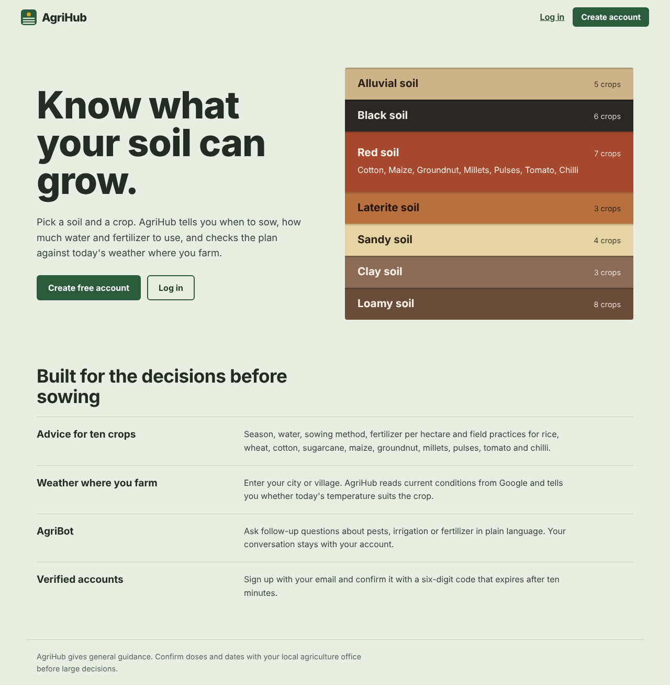
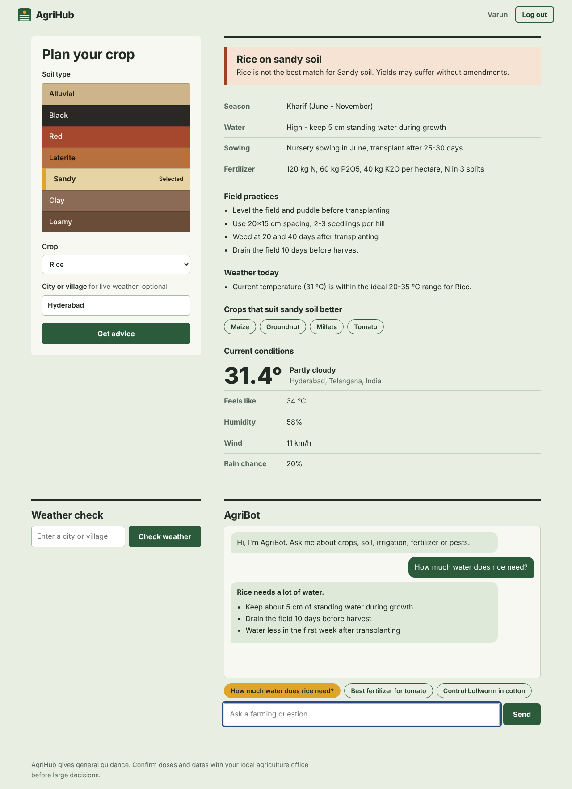

# AgriHub

Crop advice from your soil and today's weather. Pick a soil layer and a crop, and AgriHub returns the season, water, sowing method, fertilizer and field practices. It checks the plan against live weather where you farm, and an AI assistant answers follow-up questions.





*Screenshots use sample weather and chatbot responses.*

## Features

| Feature | Where it lives |
|---|---|
| Crop recommendation by soil and crop (10 crops, 7 soils) | `crop_data.py`, `/api/recommend` |
| Real-time weather (Google Weather API, with free Open-Meteo fallback) | `fetch_weather()` in `app.py` |
| AI chatbot (Gemini) with saved history | `ask_chatbot()` in `app.py`, `/api/chat` |
| Email OTP registration and login | `/register`, `/verify`, `/resend-otp`, `/login` |
| SQL database for users, OTPs, searches and chats | `schema.sql` |

**Tech stack:** Python, Flask, HTML, CSS, JavaScript, SQL (SQLite), Google Cloud APIs, Gemini.

## Project structure

```
agrihub/
├── app.py              Flask app: routes, OTP, weather, chatbot
├── crop_data.py        Soil and crop knowledge base, recommend()
├── schema.sql          Database tables
├── check_gemini.py     Finds which Gemini models your key can use
├── requirements.txt
├── render.yaml         One-click Render deployment
├── .env.example        Copy to .env and fill in
├── templates/          landing, login, register, verify, dashboard
├── static/             style.css, app.js, landing.js
└── docs/               README screenshots
```

## Run it locally

```bash
python3 -m venv venv
source venv/bin/activate          # Windows: venv\Scripts\activate
pip install -r requirements.txt
cp .env.example .env              # then fill in your keys
python3 app.py
```

Open http://127.0.0.1:5000. The app runs with no keys: OTP codes print in the terminal, and weather and chat explain what is missing.

## Keys you need

1. **Weather (optional key):** with no key, AgriHub uses the free Open-Meteo service. For Google's data, enable the **Weather API** and **Geocoding API** in Google Cloud Console (billing required), create an API key, and set `GOOGLE_API_KEY`. If the Google call fails, the app falls back to Open-Meteo automatically.
2. **Chatbot:** create a key at https://aistudio.google.com/apikey and set `GEMINI_API_KEY`. Run `python3 check_gemini.py` to see which models respond, then set `GEMINI_MODEL` to one marked WORKS.
3. **Email OTP:**
   - *Local:* Gmail SMTP. Turn on 2-Step Verification, create an App Password, and set `SMTP_USER` and `SMTP_PASS`.
   - *Deployed:* most free hosts block SMTP, so use Brevo's HTTPS API. Create a free account at brevo.com, verify a sender address, create an API key, and set `BREVO_API_KEY` and `BREVO_SENDER`. Brevo is used first when set.

Never commit `.env`. It is already in `.gitignore`.

## Chatbot troubleshooting

A 503 means Google is temporarily overloaded. AgriBot retries, then tries the models in `GEMINI_FALLBACK_MODELS`, then any Flash model your key can list. If nothing answers, the chat shows a short notice and no error text is saved to your history.

## Push to GitHub

```bash
git init
git add .
git status          # confirm .env, venv/ and agrihub.db are NOT listed
git commit -m "AgriHub: crop advice with weather, AI chatbot and email OTP"
git branch -M main
git remote add origin https://github.com/<your-username>/agrihub.git
git push -u origin main
```

## Deploy on Render (free)

1. Push the repo to GitHub.
2. On render.com choose **New, then Blueprint**, and connect the repo. `render.yaml` fills in the build and start commands.
3. Add the secret variables: `GOOGLE_API_KEY`, `GEMINI_API_KEY`, `BREVO_API_KEY`, `BREVO_SENDER`. `SECRET_KEY` is generated for you.
4. Deploy, open the `onrender.com` address, and register to test the OTP email.

Free-tier limits: the disk is ephemeral, so the SQLite database resets on each deploy or restart, and the service sleeps when idle. For permanent data, move to a hosted database such as Neon (Postgres) or Aiven (MySQL).

## How it works

- **Recommendations:** `recommend(soil, crop, temp)` checks soil suitability, returns season, water, sowing, fertilizer and practices, suggests better-suited crops for a poor match, and adds temperature advice when weather is available.
- **Weather:** the city is geocoded, then current conditions come from the Google Weather API when a key is set, otherwise from Open-Meteo. The card shows which source answered.
- **Chatbot:** the last 10 messages are sent to Gemini with a farming instruction. Replies render with basic formatting (bold and bullet lists).
- **OTP:** six digits from `SystemRandom`, stored hashed, expiring after 10 minutes, with 5 attempts. Passwords are hashed with Werkzeug and all SQL is parameterized.

The advice is general guidance. Confirm doses and dates with a local agriculture office.
